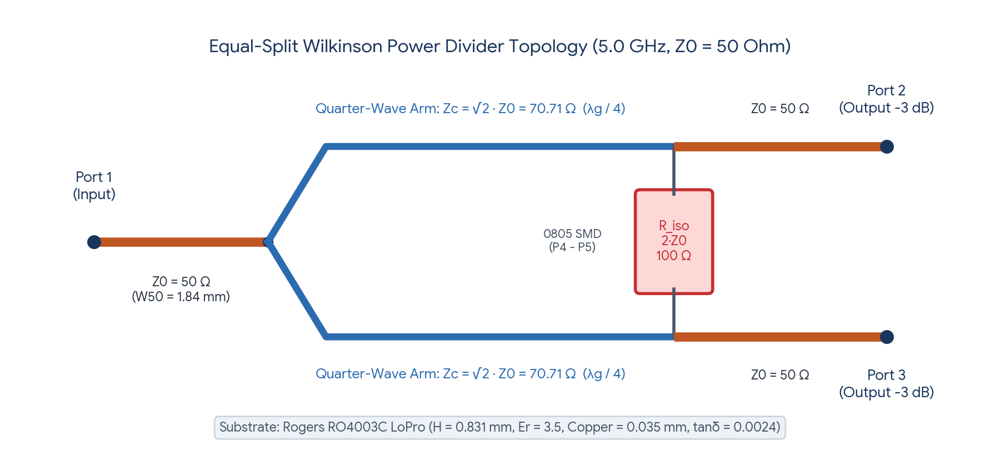

# Phase 01 — Theory, Specifications & Initial Design

**Full Report:** [`Phase_01_Theory_and_Specifications_Report.docx`](./Phase_01_Theory_and_Specifications_Report.docx)

## Overview
This phase establishes the microwave engineering theory behind a 5.0 GHz Equal-Split Wilkinson Power Divider ($Z_0 = 50\,\Omega$), explains why a simple T-junction cannot achieve simultaneous matching and isolation, selects **Rogers RO4003C LoPro** ($H = 0.831\text{ mm}$, $D_k = 3.5$, $T = 0.035\text{ mm}$, $\tan\delta = 0.0024$), and synthesizes the baseline microstrip dimensions (`W50 = 1.84 mm`, `W70 = 0.984 mm`, `Lh = 4.875 mm`).

