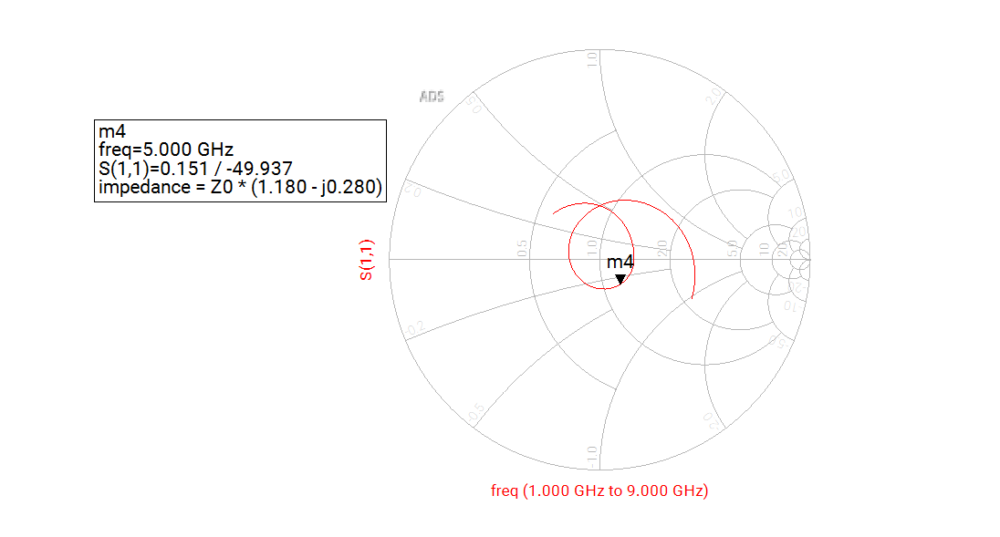

# Phase 02 — Baseline Full-Wave EM Co-Simulation (V1)

**Full Report:** [`Phase_02_Baseline_EM_CoSimulation_Report.docx`](./Phase_02_Baseline_EM_CoSimulation_Report.docx)

## Overview
Transitions the design from analytical schematic models (`03_Real_Microstrip`) to **Keysight ADS Momentum** full-wave EM simulation (`04_Microstrip_EM`) using a 5-port EM Co-Simulation testbench (`05_EM_CoSim`) where the `100 Ω` isolation resistor is connected across Direct ports `P4` and `P5`.

### Key Findings (`V1` at 5.000 GHz)
* `S(1,1) = -16.405 dB` (dip shifted to `~5.85 GHz`), `S(2,2) = -14.878 dB`, `S(2,3) = -27.216 dB`
* `S(2,1) = -3.298 dB`, `S(3,1) = -3.295 dB` (after correcting copper thickness to `0.035 mm`)
* **Smith Chart Diagnosis:** `Z_in = Z0 * (1.180 - j0.280)` revealed higher effective arm impedance and corner-cutting shortening, directly guiding Phase 03 retuning.

