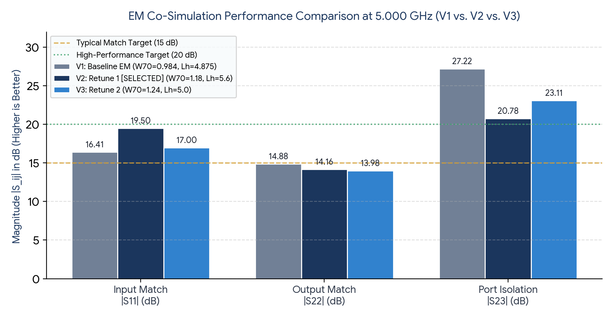

# Phase 03 — EM-Based Retuning & Version Comparison (V1 → V2 → V3)

**Full Report:** [`Phase_03_EM_Retuning_and_Version_Comparison_Report.docx`](./Phase_03_EM_Retuning_and_Version_Comparison_Report.docx)

## Overview
Documents two full-wave EM retuning iterations (`V2`: `W70 = 1.18 mm, Lh = 5.6 mm`; `V3`: `W70 = 1.24 mm, Lh = 5.0 mm`), explains the Even-Mode vs. Odd-Mode parasitic coupling capacitance trade-off, and justifies locking **`V2`** as the final fabrication design.

| Metric (5.000 GHz) | V1 (Baseline) | **V2 (Selected)** | V3 (Retune 2) |
| :--- | :---: | :---: | :---: |
| `dB(S(1,1))` | -16.405 dB | **-19.500 dB** | -17.004 dB |
| `dB(S(2,2))` | -14.878 dB | **-14.158 dB** | -13.978 dB |
| `dB(S(2,3))` | -27.216 dB | **-20.780 dB** | -23.107 dB |
| `S(2,1)` / `S(3,1)` | -3.298 / -3.295 dB | **-3.254 / -3.246 dB** | -3.304 / -3.270 dB |

