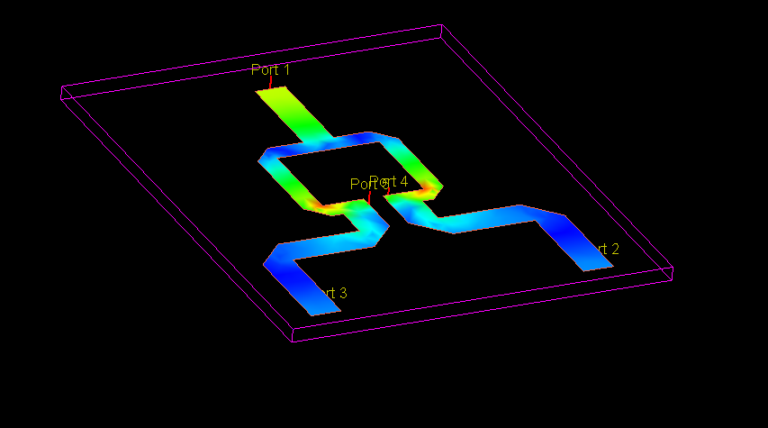

# Phase 04 — Final Layout Cleanup & 3D Surface Current Visualization

**Full Report:** [`Phase_04_Layout_Verification_and_3D_Visualization_Report.docx`](./Phase_04_Layout_Verification_and_3D_Visualization_Report.docx)

## Overview
Resolves layout geometry defects (stray overlapping pins and misoriented resistor footprint), regenerates a spotless `V2` layout, adds a discrete `5.000 GHz` point in the Momentum Frequency Plan with surface currents saved, and visualizes 3D/Top-Down **Surface Current Distribution** (`0.000`–`9.901 A/m`) confirming symmetrical 50/50 power splitting.

