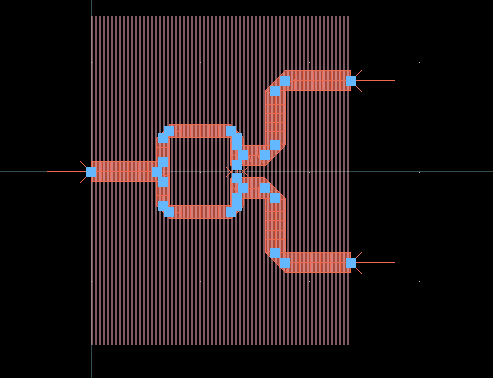

# Phase 05 — Fabrication Preparation & CAM Export (Gerber + DXF)

**Full Report:** [`Phase_05_Fabrication_and_CAM_Export_Report.docx`](./Phase_05_Fabrication_and_CAM_Export_Report.docx)

## Overview
Prepares a dedicated fabrication cell (`06_Fabrication_Layout`), verifies mechanical clearances (`16.68 mm` P2–P3 spacing, `6.00 mm` feed stubs, `1.16 mm` 0805 resistor gap), aligns the Board Outline flush with P1/P2/P3 copper edges with ample SMA margins, and exports manufacturing files in **Gerber RS-274X (`mm`)** and **AutoCAD 2004 DXF (`mm`)** along with the full Manufacturer Specification Sheet & BOM.

